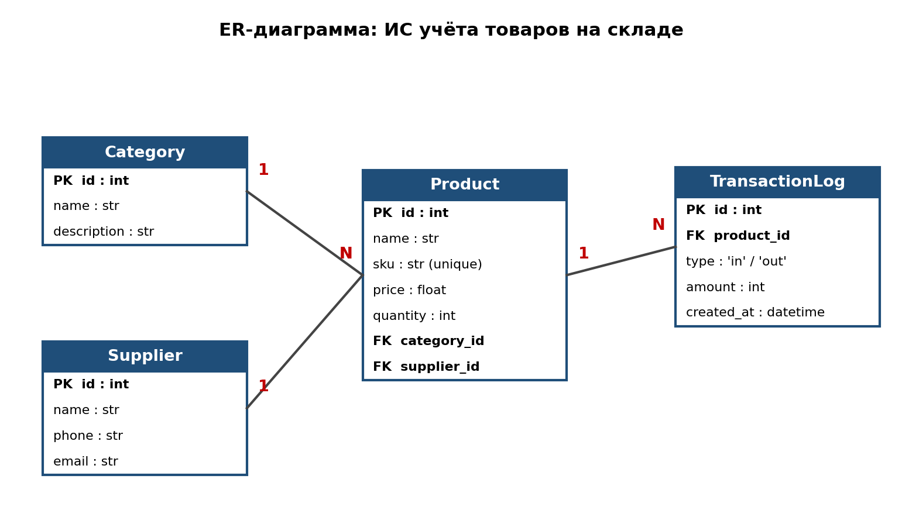

# Информационная система учёта товаров на складе

Учебный проект по дисциплине «Прикладные информационные системы» (лабораторные работы №1–4).

## Описание
ИС для учёта товаров, категорий и поставщиков с журналом прихода и расхода товара.

## Стек
Python 3, FastAPI + Uvicorn (REST API), SQLModel + SQLite (БД), Streamlit (интерфейс).

## ER-диаграмма


Связи: Category 1—N Product, Supplier 1—N Product, Product 1—N TransactionLog.

## Структура проекта
```
app/
  main.py            точка входа FastAPI
  db.py              подключение к БД, init_db, get_session
  models.py          ORM-модели и Pydantic-схемы
  routers/           эндпоинты (categories, suppliers, products, transactions)
seed.py              наполнение БД тестовыми данными
frontend/app.py      интерфейс Streamlit
docs/                ER-диаграмма
requirements.txt     зависимости
```

## Запуск
```bash
python -m venv venv
venv\Scripts\activate          # Mac/Linux: source venv/bin/activate
pip install -r requirements.txt

python seed.py                          # тестовые данные (один раз)
uvicorn app.main:app --reload           # API: http://127.0.0.1:8000/docs
streamlit run frontend/app.py           # интерфейс (во втором терминале)
```

## API
| Метод | URL | Описание |
|---|---|---|
| GET | /products | список товаров, фильтры `search`, `min_price`, `max_price`, `category_id` |
| GET | /products/{id} | товар по id (404, если нет) |
| POST | /products | создать товар (201, валидация цены и названия) |
| PATCH | /products/{id} | частично обновить товар |
| DELETE | /products/{id} | удалить товар |
| GET/POST | /categories, /suppliers | список и создание |
| GET/POST | /transactions | журнал и проведение прихода/расхода |
