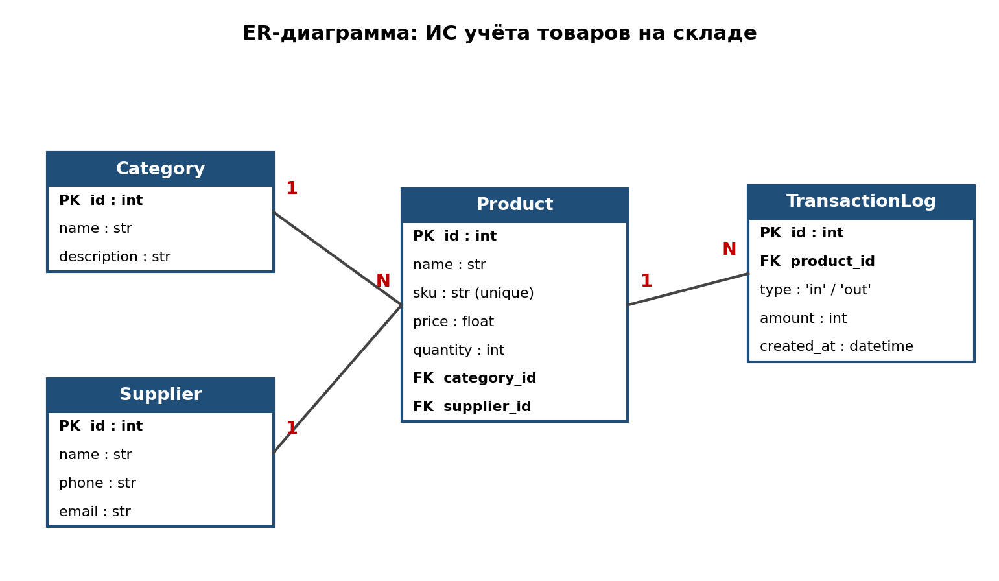

# Информационная система учёта товаров на складе

Учебный проект по дисциплине «Прикладные информационные системы» (Лабораторная работа №1).

## Описание
ИС позволяет вести учёт товаров, категорий и поставщиков, а также фиксировать приход и расход товара на складе.

## Стек
- Python 3
- FastAPI + Uvicorn — backend (REST API)
- SQLModel + SQLite — база данных
- Streamlit — пользовательский интерфейс

## ER-диаграмма


Сущности: **Category**, **Supplier**, **Product**, **TransactionLog**.
Связи: Category 1—N Product, Supplier 1—N Product, Product 1—N TransactionLog.

## Структура проекта
```
backend/
  main.py            точка входа FastAPI
  database.py        подключение к БД
  models/            модели таблиц (SQLModel)
  api/               API-эндпоинты
frontend/
  app.py             интерфейс Streamlit
docs/
  er_diagram.png     ER-диаграмма
requirements.txt     зависимости
```

## Запуск
```bash
python -m venv venv
venv\Scripts\activate          # Windows (Mac/Linux: source venv/bin/activate)
pip install -r requirements.txt

# терминал 1 — backend (документация: http://127.0.0.1:8000/docs)
uvicorn backend.main:app --reload

# терминал 2 — frontend
streamlit run frontend/app.py
```
